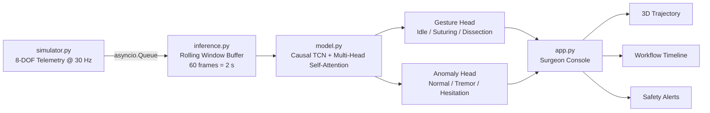

# 🩺 Intraoperative Surgical Phase & Gesture Recognition Engine

> A real-time, low-latency deep learning pipeline that classifies surgical gestures and detects
> dangerous micro-hesitations and tremors from high-frequency robotic kinematic telemetry.


---

## 📌 Overview

Modern robotic-assisted surgery (RAS) platforms generate a continuous stream of kinematic
telemetry: instrument pose, orientation, grip state, and velocity, sampled many times per
second. That stream holds a lot of information about *what* the surgeon is doing and *how
well* they are doing it.

This project is an end-to-end research prototype that:

1. **Simulates** 8-DOF surgical instrument kinematics at ~30 Hz, including realistic gestures
   (Suturing, Dissection, Idle) and injected anomalies (Tremors, Micro-Hesitations).
2. **Learns** temporal structure with an **Attention-Augmented Temporal Convolutional Network
   (TCN)**, a causal architecture built for streaming inference.
3. **Infers** in real time over a 2-second rolling window with a **< 50 ms** latency budget
   per prediction.
4. **Visualizes** everything in a Streamlit **"Surgeon Console"** with a live 3D instrument
   trajectory, a real-time surgical workflow timeline, and a tiered safety alert system.

---

## 🏗️ System Architecture



### Design Principles

| Principle | Implementation |
|---|---|
| **Causality** | Causal (left-padded) dilated convolutions, so the model never sees future frames, exactly as in a live OR. |
| **Long-range context** | Exponentially dilated TCN blocks with residual connections give a wide receptive field without vanishing gradients. |
| **Global reasoning** | A Multi-Head Self-Attention layer over TCN features captures relationships across the full 2 s window (e.g., a pause *after* a needle drive). |
| **Multi-task learning** | Separate gesture and anomaly heads share one backbone. A surgeon can be *suturing* **and** *hesitating* at the same moment. |
| **Latency first** | Fixed-size ring buffer, preallocated tensors, `torch.inference_mode()`, and optional TorchScript export. |

---

## 📡 Telemetry Schema

Each frame emitted by the simulator contains the 8 degrees of freedom of the instrument pose,
plus one derived kinematic channel:

| Index | Channel | Description | Unit |
|---|---|---|---|
| 0–2 | `x, y, z` | Instrument tip translation | mm |
| 3–6 | `qw, qx, qy, qz` | Orientation as a unit quaternion | – |
| 7 | `grip` | Jaw / grip opening angle | rad |
| 8 | `velocity` | Instantaneous tip speed (derived) | mm/s |

**Pose DOF = 8** (3 translation + 4 quaternion + 1 grip). **Model input features = 9**
(pose + velocity).

---

## 📂 Repository Structure

surgical-gesture-engine/
├── README.md # You are here
├── requirements.txt # Pinned dependencies
├── simulator.py # Async 30 Hz 8-DOF kinematic telemetry generator
├── model.py # Attention-Augmented Causal TCN (multi-task)
├── train.py # Training loop with F1 / accuracy tracking
├── inference.py # Low-latency rolling-window inference engine
├── app.py # Streamlit "Surgeon Console" dashboard
└── checkpoints/ # Saved model weights (created by train.py)

---

## ⚙️ Setup

### Prerequisites
- Python **3.10+**
- (Optional) CUDA-capable GPU or Apple Silicon (MPS). The model is small enough to run
  inference comfortably on CPU.

### 1. Clone the repository
```bash
git clone https://github.com/9Anthony0/surgical-gesture-engine.git
cd surgical-gesture-engine
```

### 2. Create and activate a virtual environment
```bash
python -m venv .venv
source .venv/bin/activate        # macOS / Linux
.venv\Scripts\activate           # Windows
```

### 3. Install dependencies
```bash
pip install --upgrade pip
pip install -r requirements.txt
```

**`requirements.txt`**
torch>=2.1
numpy>=1.24
scikit-learn>=1.3
streamlit>=1.30
plotly>=5.18
pandas>=2.0

---

## 🚀 Quickstart

### Step 1: Train the model
Generates a synthetic dataset from the simulator and trains the Attention-TCN:
```bash
python train.py --epochs 25 --batch-size 64 --lr 1e-3
```
The best checkpoint (by validation macro-F1) is saved to `checkpoints/best_model.pt`.

### Step 2: Benchmark inference latency
```bash
python inference.py --benchmark --iterations 1000
```
This reports p50 / p95 / p99 latency per prediction on your hardware.

### Step 3: Launch the Surgeon Console
```bash
streamlit run app.py
```
Open `http://localhost:8501` to watch the live 3D trajectory, workflow timeline, and safety
alerts update in real time.

---

## 🧠 Model: Attention-Augmented Causal TCN

Input (B, 60, 9)
│
├─► Input Projection (Linear → 64 channels)
│
├─► Causal TCN Block ×4 (kernel=3, dilation = 1, 2, 4, 8)
│ └─ Conv1d → LayerNorm → GELU → Dropout → Residual
│
├─► Multi-Head Self-Attention (4 heads, causal mask) + Residual + LayerNorm
│
├─► Temporal Pooling (last-step + attention-weighted mean)
│
├─► Gesture Head → 3 classes (Idle, Suturing, Dissection)
└─► Anomaly Head → 3 classes (Normal, Tremor, Hesitation)


**Why TCN instead of an LSTM?** TCNs process the whole window in parallel, have stable
gradients through residual paths, and give a deterministic receptive field. At streaming
inference time, that means predictable latency, which matters more than peak throughput in a
safety-critical system.

**Why add attention?** Dilated convolutions capture local motion primitives well, but
hesitation is often *relational*: a sudden velocity collapse relative to the preceding motion
pattern. Self-attention lets every timestep compare itself against the entire window.

**Loss:** Weighted sum of two CrossEntropy losses, with class weighting on the anomaly head to
counter the rarity of tremor and hesitation events.

---

## ⏱️ Latency Budget

Target end-to-end budget per prediction at 30 Hz (one frame every ~33 ms):

| Stage | Target |
|---|---|
| Queue dequeue + buffer update | < 1 ms |
| Normalization + tensor prep | < 2 ms |
| Model forward pass (CPU) | < 15 ms |
| Post-processing + smoothing | < 2 ms |
| **Total** | **< 50 ms (hard ceiling)** |

Run `python inference.py --benchmark` to measure actual numbers on your machine.

---

## 📊 Evaluation Metrics

- **Macro-F1** (primary): robust to class imbalance, which is critical because anomalies are rare.
- **Accuracy**: reported per head for interpretability.
- **Per-class precision / recall**: in a safety context, **recall on Hesitation and Tremor**
  matters most. A missed anomaly costs more than a false alarm.

---

## 🩺 Why I Built This

My motivation for transitioning my machine learning work into surgical robotics comes from
seeing both sides of the patient experience. My grandma recently underwent several major heart
surgeries that unfortunately didn't resolve her underlying issues, showing me how microscopic
the margins of error are in the OR. Not long after, I ended up in the ER with a deep forehead
laceration. Watching the trauma team work under immense pressure gave me a profound respect for
the cognitive load placed on surgeons. I built this real-time kinematic engine to act as a
safety net—using low-latency AI to catch micro-hesitations or fatigue before they become
mistakes, allowing the surgical team to focus entirely on patient outcomes.

---

## ⚠️ Limitations & Disclaimer

- **Research prototype only.** This software is **not** a medical device, has not been
  clinically validated, and must not be used for any clinical decision-making.
- **Synthetic data.** All telemetry is simulated. Real surgical kinematics have richer
  structure, inter-surgeon variability, and sensor artifacts that this simulator only
  approximates.
- **No affiliation.** This is an independent portfolio project. It is not affiliated with,
  endorsed by, or built on proprietary technology from Medtronic, Touch Surgery™, or the
  Hugo™ RAS system. All trademarks belong to their respective owners.

---

## 🗺️ Roadmap

- [ ] Validate on the public **JIGSAWS** surgical kinematics dataset (JHU-ISI Gesture and
      Skill Assessment Working Set)
- [ ] Add video + kinematics multimodal fusion
- [ ] Export to ONNX / TensorRT for edge deployment
- [ ] Surgeon-specific calibration via few-shot fine-tuning
- [ ] Uncertainty estimation (MC Dropout) to suppress low-confidence alerts
- [ ] Skill assessment scoring (OSATS-inspired metrics)

---

## 📄 License

MIT License. See `LICENSE` for details.

---

## 🙏 Acknowledgments

Inspired by research in surgical data science, including work on the JIGSAWS dataset and
Temporal Convolutional Networks for action segmentation (Lea et al., 2017).